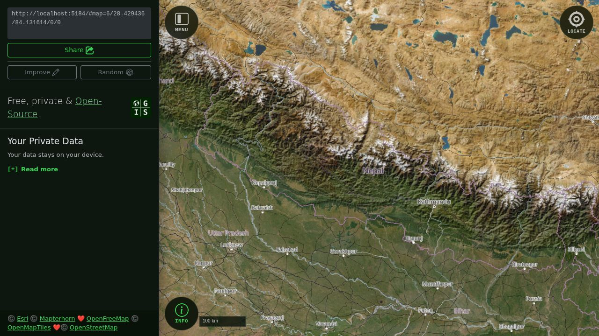
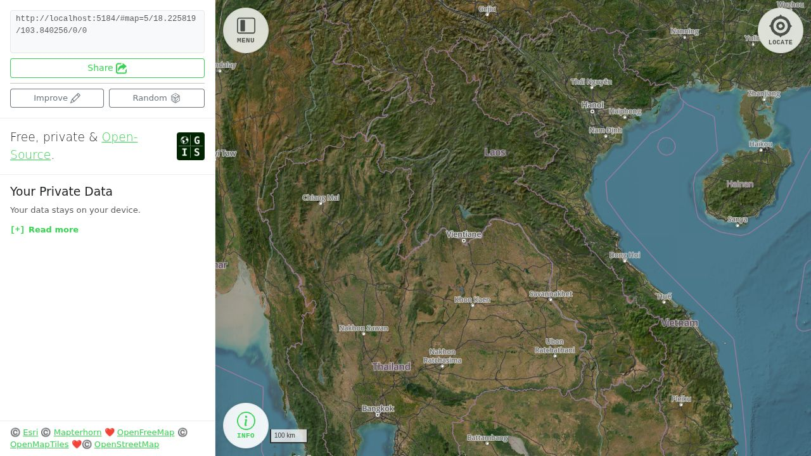

[ogis.app](https://www.ogis.app/?country=random)

> A navigational tool to rule them all, right in the browser.

No API keys, no registration, no app stores and no invasions of privacy.

A _loveletter_ to the [OpenStreetMap](https://www.openstreetmap.org/) ecosystem ❤️ Special thanks to [OpenFreeMap](https://openfreemap.org/) for tile hosting.

> [!NOTE]
> The app is currently in **SPA front-end only mode** — the account, maps and collections features (which require a backend) are disabled in the UI.

## Screenshots





Both heroes are live, intentionally non-deterministic captures — a random-country cold start with the Info panel open — refreshed in place by every full local E2E run, and rebuilt and committed back automatically whenever a release is cut. The committed screenshot matrix is under [`screenshots/`](screenshots/); see [Screenshot matrix](#screenshot-matrix).

## Technical overview

ogis.app is a **Vue 3 + Vite** single-page application and an **installable PWA** ([`public/manifest.json`](public/manifest.json), `display: standalone`) — the map is [MapLibre GL JS](https://maplibre.org/) with a Bootstrap SCSS theme, and a hand-rolled service worker ([`public/sw.js`](public/sw.js), no Workbox) provides the app shell and offline map support. The backend features (account, maps, collections) are disabled in the current SPA front-end only mode.

- **Entry point** — [`src/main.js`](src/main.js) reads the URL parameters, creates the Vue app, installs the core features and mounts to `#app`.
- **Resilience** — persisted stores use a versioned envelope with hydration and quarantine; boot failures are contained and a static fallback covers a failed module load. The map view and shared routes, recordings and offline regions sync live across tabs, while locate, route-navigation and active-recording sessions restore in the tab where they started. Critical transitions flush immediately, recordings restore paused, and map recovery surfaces style and WebGL failures. See [State and resilience](docs/16.state-and-resilience.md).
- **Features** — self-contained bundles registered from `src/main.js`; each is a plain object with an `install(ctx)` method that registers a side-panel tab and/or a corner control chip. See [Features](docs/10.features.md).
- **Tracks** — routes, recordings and waypoint documents share a versioned `v: 2` model in [`src/utils/track/`](src/utils/track/) for import, export, distance and legacy migration; GeoJSON is a render/export projection. See [Tracks](docs/15.tracks.md).
- **Actions and modes** — camera-taking actions claim the map from sustained modes (following, offline draw, route navigation) so state is reconciled before the camera moves. See [UI actions and map modes](docs/5.ui.md#ui-actions-and-map-modes).
- **Composables** — per-instance state lives in `src/composables/`, cached in a module-level `Map` keyed by the instance id (the `?id=` URL parameter). See [Instances](docs/3.instances.md).
- **Offline** — the service worker caches the app shell and map resources; the Offline feature pre-warms its cache by fetching every tile and glyph URL for a region. See [Offline](docs/12.offline.md).

Full developer documentation lives in [docs/README.md](docs/README.md).

## Features

- Detailed, free global map — no install, no account
- Globe view on first load
- Corner controls for menu and locate, plus a merged Info panel (share links, app info, privacy)
- GPS locate with compass heading
- Record GPS tracks and share them as GPX or GeoJSON
- Import GPX and GeoJSON routes and waypoints, then navigate offline in follow mode — the top-centre navigation card shows a direction arrow with the distance back to the route, or `On route` when you are on it, with a green dashed on-map connector to the nearest point on the route when you are off route within 1 km
- Show or hide each saved route or recording independently, with direction chevrons on the map
- Download map regions for offline use (via a service worker)
- Multilingual — follows your device language
- Shareable camera views
- Map view and shared routes, recordings and offline regions sync live across tabs
- Map view persisted between sessions
- Locate, route navigation and an active recording restored after a reload in the same tab
- Light and dark mode, following your device setting
- Works on any device

> [!NOTE]
> **Offline maps** — drag a region on the map to download its tiles and glyphs for offline use. A hand-rolled service worker (`public/sw.js`) caches the app shell and map resources; see [docs/12.offline.md](docs/12.offline.md).

## Drawbacks and Limitations

- Location permissions are required for GPS/Compass features. Some users have a deny-all approach to browser permissions and changing them varies between browsers and devices.
- The app does not work in the background or when the device is locked — a common limitation of web apps.
- The app requires an initial connection to load assets and map tiles, even though it works offline thereafter.
- Session restore is best-effort and partial: a normal reload in the same tab restores locate, navigation and an active recording, but a hard kill or force-quit can lose the most recent debounced change, and a full browser restart may start those sessions fresh. Another tab never sees them. UI/panel state, map projection, theme, units, locale and saved-recording visibility are not restored.

## Planned Changes

- Much more language support
- Better handling of denied location permissions

## Thanks Open Source!

| Component          | Source                                                                                                            |
| ------------------ | ----------------------------------------------------------------------------------------------------------------- |
| **Map Data**       | &copy; [OpenStreetMap contributors](https://www.openstreetmap.org/copyright)                                      |
| **Tile Hosting**   | [OpenFreeMap](https://openfreemap.org)                                                                            |
| **Rendering**      | [MapLibre GL JS](https://maplibre.org/)                                                                           |
| **Tile Schema**    | [OpenMapTiles](https://www.openmaptiles.org/) / [OSM Bright](https://github.com/openmaptiles/osm-bright-gl-style) |
| **User Interface** | [Vue JS](https://vuejs.org/) / [Bootstrap](https://getbootstrap.com/)                                             |
| **Icons**          | [OpenGIS icons](https://github.com/OpenGIS/icons) / [Bootstrap Icons](https://github.com/twbs/icons)              |

## Development

### Quick start

Requires **Node 24** — the unit suite depends on `Intl.Locale.prototype.getTimeZones`.

```bash
git clone https://github.com/OpenGIS/app.git
npm install
npm run dev     # http://localhost:5174
npm run build   # production build to dist/
npm run preview # build, then serve the production build at http://127.0.0.1:4173
```

E2E runs on a fresh machine also need the Chromium build: `npx playwright install chromium`.

### Development workflow

The canonical loop, from first checkout to merge. Deep dives are linked inline:

1. **Set up** — see [Quick start](#quick-start).
2. **Inner loop** — `npm run watch:e2e` reruns the functional E2E suite on change; run a single spec with `npm run test:e2e -- tests/e2e/{spec}.spec.js`; unit tests are `npm test`. Deep dive: [Testing — Local iteration loops](docs/9.testing.md#local-iteration-loops).
3. **UI changes** — capture the screenshot matrix with `npm run test:matrix` (writes to a temp directory), then inspect what moved with `npm run screenshots:diff` (relative/visual report). See [Screenshot matrix](#screenshot-matrix).
4. **Format** — `npm run format`. CI gates on `npm run format:check`.
5. **Pre-push gate** — `npm run check` (Prettier check + unit tests) before pushing.
6. **Commit and push** — Conventional Commits only (see [Contributing](#contributing)).
7. **CI is the gate** — green `ci.yml` on your pushed commits means done: the unit suite, the commit-message check and the functional E2E suite. The screenshot matrix is deliberately outside the push path — verified on pull requests and healed on `master` on its own schedule; see [Screenshot matrix](#screenshot-matrix). The full local E2E run (`npm run test:e2e` — the functional specs plus the README heroes; the matrix is a separate capture) is an optional fallback — offline, or when the local GPU functional path is specifically wanted. See [CI](docs/13.ci.md).

### Screenshot matrix

The committed PNGs under [`screenshots/`](screenshots/) are visual evidence that ships with the repository: core chrome states and the locate permission modals across phone, tablet and desktop in both orientations, plus the fully-populated feature states and secondary UI states at desktop landscape. Captures run in a dedicated, always-software-rendered Playwright project with a dark theme and a pinned locale, so they are reproducible run-to-run on a given machine.

- **Local** — `npm run test:matrix` captures into a gitignored temp directory; local runs never touch the committed PNGs. `npm run screenshots:diff` reports what moved, whether comparing a local capture against the committed matrix or two local capture trees before and after a change; `npm run screenshots:bundle` builds the same reviewable diff bundle the workflow attaches — before/after/pixel-diff PNGs plus a self-contained HTML index.
- **CI verification** — the `Screenshots` GitHub workflow captures the matrix on macOS shards and verifies the captures against the committed PNGs within a strict pixel tolerance: sub-level anti-aliasing drift is tolerated and reported, while real changes fail. An aggregate job checks the full matrix in both directions; on a pull request a move opens a diff bundle (and, for same-repository PRs, a sticky comment with inline diffs).
- **Re-baselining** — when a scheduled or manually dispatched run on `master` genuinely moves the matrix (verification fails beyond tolerance), the workflow's `refresh` job rebuilds the committed baseline automatically from that run's own captured artefacts, so the developer just `git pull`. Pushes never run the matrix, the heal defers — green — while a `ci.yml` run is in flight or after `master` has advanced, and there is no dispatched re-verification: the next run verifies. Pull requests stay strict (a red verification is a review signal) and sub-tolerance drift never triggers it. `npm run screenshots:fetch -- --run <run-id> [--write]` is the manual exception path for a PR or a failed/incomplete capture set — never from local captures.

See [docs/9.testing.md](docs/9.testing.md) for the testing strategy and [docs/13.ci.md](docs/13.ci.md) for the workflow details.

### Backend API base URL

Set the backend API origin for cross-subdomain auth/API calls:

> [!NOTE]
> Only needed when the auth/backend features are re-enabled — the app currently runs in SPA front-end only mode.

```bash
echo "VITE_API_BASE_URL=https://api.example.com" > .env.local
```

### Icons

Icon sources are vendored in `src/icons/` alongside the committed generated bundle.

```bash
npm run icons:build   # regenerate the bundle after adding or updating source icons
```

See [docs/14.icons.md](docs/14.icons.md) for the pipeline.

## Contributing

The end-to-end journey, checkout to release:

1. **Set up** — see [Quick start](#quick-start).
2. **Make the change** — follow the [Development workflow](#development-workflow).
3. **Run the pre-push gate** — `npm run check` (Prettier check + unit tests).
4. **Commit** — a [Conventional Commit](https://www.conventionalcommits.org/en/v1.0.0/): `<type>(optional scope): <description>`, e.g. `fix(offline): purge stale tile URLs`. The [type table](docs/13.ci.md#conventional-commits-are-required) maps types to release impact; breaking changes use `!` or a `BREAKING CHANGE:` footer.
5. **Push and open a PR** — a `master` push runs `ci.yml` alone (unit suite, commit check, functional E2E; release and deploy follow); a PR additionally runs the `Screenshots` workflow, which verifies the committed matrix and opens a diff bundle (plus a sticky comment on same-repository PRs) when it moves. A red matrix on a PR is a review signal for a real visual change — advisory only, as no branch protection is configured.
6. **After merge** — the `release` job cuts versions, changelogs and GitHub releases from the commit messages; the README heroes refresh automatically on each release; a genuinely moved screenshot matrix is re-baselined by the next scheduled (or manually dispatched) `Screenshots` run on `master`.

[AGENTS.md](AGENTS.md) is the project's conventions file — the same journey, commands and gates in agent-facing form.

## Docs

See [docs/README.md](docs/README.md) for the full developer documentation.
