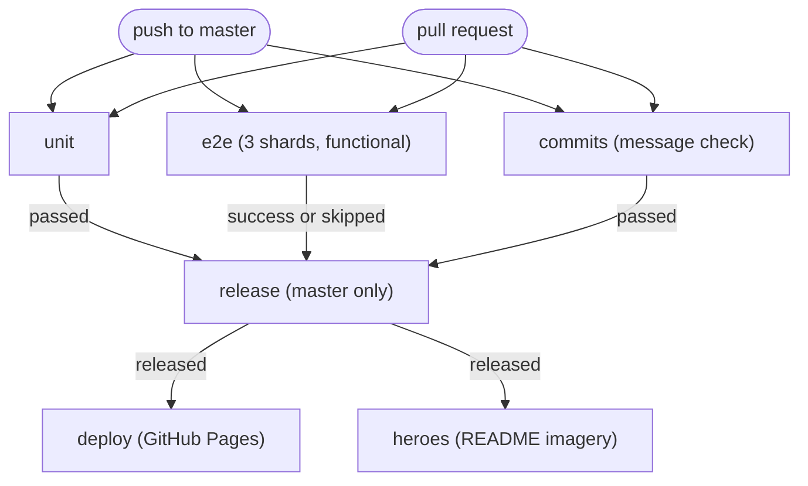

# CI — tests, releases and deployment

GitHub Actions runs the test suites, validates commit messages, cuts releases with semantic-release, and deploys to GitHub Pages.

---

## Two workflows

| Workflow                                                  | Role                                           | Pull request             | Push to `master`                                             | Schedule (daily, 07:30 UTC) / `workflow_dispatch`                 |
| --------------------------------------------------------- | ---------------------------------------------- | ------------------------ | ------------------------------------------------------------ | ----------------------------------------------------------------- |
| [`ci.yml`](../.github/workflows/ci.yml)                   | The fast gate                                  | `unit`, `e2e`, `commits` | `unit`, `e2e`, `commits`, then `release`, `deploy`, `heroes` | —                                                                 |
| [`screenshots.yml`](../.github/workflows/screenshots.yml) | The visual authority for the screenshot matrix | `screenshots`, `verify`  | — (never runs on pushes)                                     | `screenshots`, `verify`, then `refresh` on a verification failure |

**`ci.yml`** is the fast gate; **`screenshots.yml`** is the visual authority. No branch protection is configured, so the aggregate **`Screenshots — verify committed matrix`** job is advisory rather than a required check: on a pull request a red matrix is a review signal, presented as a diff bundle and sticky comment, while a scheduled or manually dispatched run on `master` hands a move to the workflow's own heal. The aggregate job — not the `screenshots` shard job — is the authoritative matrix check (see [why](#screenshot-matrix-workflow)), but nothing waits on it: a push runs `ci.yml` alone.

### Runner setup

Both workflows share the same runner conventions:

- Node 24 is pinned in every job via `actions/setup-node` with the npm cache; every job that installs dependencies uses `npm ci`.
- The `e2e` job installs Chromium with `npx playwright install --with-deps chromium`; the `screenshots` capture shards install the plain `chromium` build.
- Job timeouts are explicit where they matter: 30 minutes per `e2e` shard, 30 minutes for the `heroes` run, 180 minutes per `screenshots` capture shard, 15 minutes for the aggregate `verify` and the `refresh` heal.
- Concurrency: `ci.yml` groups per ref (`ci-${{ github.ref }}`) and cancels in-progress runs for pull requests only; `screenshots.yml` uses its own per-ref group (`screenshots-${{ github.ref }}`) with the same PR-only cancellation. `deploy` has its own `pages` group with `cancel-in-progress: false`, so a deployment is never cut off mid-flight.
- The `e2e` job splits the functional suite across three shards — a quick gate, with Playwright running serially within each shard (`workers: 1` via the deterministic path). The `screenshots` workflow captures across six shards because each macOS capture is slow under the deterministic single-thread SwiftShader pin, and parallel shards keep the wall-clock time down.

---

## ci.yml — triggers and jobs

`unit`, `e2e` and `commits` run in parallel on every push and pull request. `release`, `deploy` and `heroes` follow only on `master` pushes; `release` requires `unit` and `commits` to pass and accepts `e2e` only as `success` or `skipped`. A push can skip the functional shards with the [skip marker](#skipping-the-e2e-shards). Release is push-driven only: `ci.yml` has neither a `workflow_dispatch` trigger nor a schedule, so there is no manual way to dispatch one — a release is cut by landing a release-worthy Conventional Commit on `master`. The `release` job then starts as soon as its gate jobs pass on that push; there is no scheduled or off-peak release window.



| Job       | Runs on                                                                | What it does                                                                                                                                                                                                             |
| --------- | ---------------------------------------------------------------------- | ------------------------------------------------------------------------------------------------------------------------------------------------------------------------------------------------------------------------ |
| `unit`    | Every push and PR                                                      | `npm ci`, a Prettier format check (`npm run format:check`), then `npm test` (Vitest) with `CI=1`                                                                                                                         |
| `e2e`     | Every push and PR (skippable on push)                                  | Installs Chromium (`--with-deps`), runs the functional suite as a 3-shard matrix (`--grep-invert @screenshots --shard=N/3`, `CI=1`), uploads per-shard `playwright-report/` even on failure. 30-minute timeout per shard |
| `commits` | Every push and PR                                                      | Runs `node .github/scripts/checkCommits.mjs` over the push/PR range: every non-merge subject must follow Conventional Commits; needs only `git` and Node                                                                 |
| `release` | `master` pushes; `unit` and `commits` passed, `e2e` success or skipped | `npx semantic-release` with `GITHUB_TOKEN`; exposes `released` and `sha` outputs (the latter only on an actual release)                                                                                                  |
| `deploy`  | Only when `released == true`                                           | Checks out the released `sha`, builds `dist/`, uploads the Pages artefact and deploys to GitHub Pages                                                                                                                    |
| `heroes`  | Only when `released == true`                                           | Regenerates the README heroes with the live `readme.spec.js` capture and commits them back to `master` as the bot. 30-minute timeout                                                                                     |

- The `e2e` job is a three-shard matrix with `fail-fast: false`; each shard runs `npm run test:e2e -- --grep-invert @screenshots --shard=N/3` with `CI=1`, so CI uses SwiftShader software rendering and two retries. Because `CI=1` selects the deterministic path, the job also runs as a single worker under the single-thread SwiftShader pin (see [Testing — E2E rendering modes](./9.testing.md#e2e-rendering-modes)). The `@screenshots` matrix specs are excluded from `ci.yml` and verified instead by the separate [`screenshots.yml`](#screenshot-matrix-workflow) workflow; the extra `--grep-invert @screenshots` also keeps the README heroes (tagged `@screenshots`) out of the functional shards. Each shard has a 30-minute timeout.
- The `e2e` job has no live map-asset dependency: the shared test fixture serves the MapLibre style, sprites and glyphs from the committed fixtures under `tests/fixtures/map/`, unvendored tiles/glyphs default to an instant empty 200, and the context-level stub blocks any other external request, so no shard fetches a live map origin. Refreshing those fixtures (`npm run fixtures:refresh`) is a manual local step and deliberately not part of CI — see [Testing — Map-asset fixtures](./9.testing.md#map-asset-fixtures).
- The `commits` job checks every message in the run's range: [`.github/scripts/checkCommits.mjs`](../.github/scripts/checkCommits.mjs) reads `BEFORE..AFTER` (the PR base for pull requests, the previous tip for pushes) and validates each non-merge subject, allowing the types tabled in [Conventional commits are required](#conventional-commits-are-required) — the same list as the checker's exported `ALLOWED_TYPES` — plus `revert`; git-native `Revert "…"` subjects are exempt. It uses only `git` and the Node standard library — nothing to install — and its `success` is a hard gate on `release`.
- Default workflow permissions are `contents: read`. `release` escalates to `contents: write`, `issues: write` and `pull-requests: write`; `heroes` needs `contents: write` to push the refreshed imagery; `deploy` needs `pages: write` and `id-token: write`.
- A push can skip the three functional shards with a marker in its head commit message — see [Skipping the e2e shards](#skipping-the-e2e-shards).
- `deploy` checks out the released commit — `needs.release.outputs.sha`, not `master` — so a mid-run push to `master` cannot leak unreleased commits into the build, then passes `VITE_API_BASE_URL` from the repository's Actions variables into `npm run build`.
- `heroes` runs only when a release is actually cut (`released == true`), so it never fires on a pull request or a `master` push that produces no version. It installs Chromium and runs the live `tests/e2e/screenshots/readme.spec.js` capture (the `chromium` Playwright project, SwiftShader under `CI=1`), which writes `DARK.jpg` and `LIGHT.jpg` into the repo root. If either image changed it commits them back to `master` as `github-actions[bot]` — `chore(readme): refresh heroes for v<version> [skip ci]`, falling back to a version-less subject if the version cannot be read — then `git pull --rebase` and pushes. This is the release-time companion to the screenshot matrix's scheduled [`refresh`](#screenshot-matrix-workflow): both keep committed visual artefacts current, but the heroes are regenerated on a release, whereas the matrix heals on the next scheduled or dispatched run that detects a move.

> [!NOTE]
> Why the fast `ci.yml` gate excludes the screenshot matrix: GitHub runners render with SwiftShader, where captures are far slower than local GPU rendering, so running the matrix inline would consume a disproportionate amount of runner CPU. The matrix is verified instead by the separate [`screenshots.yml`](#screenshot-matrix-workflow) workflow, which reproduces the committed matrix in its macOS capture shards within a strict pixel tolerance and aggregates the check on Linux. Local verification stays relative and visual (see [Testing — Screenshot diff loop](./9.testing.md#screenshot-diff-loop)); committed-matrix re-baselining is sourced from this workflow's captures (see [Testing — CI-sourced re-baseline](./9.testing.md#ci-sourced-re-baseline)).

### Screenshot matrix workflow

[`.github/workflows/screenshots.yml`](../.github/workflows/screenshots.yml) is the deterministic authority for the committed screenshot matrix. It runs on pull requests, a daily schedule (07:30 UTC, off-peak) and `workflow_dispatch` — deliberately **never on pushes**, so a matrix run can neither gate nor race a release; `ci.yml` is untouched and shares no path with it. It has four jobs: the capture shards, an aggregate `verify` gate, a `refresh` heal (scheduled and dispatched `master` runs only) and a final `matrix-status` summary.

- **`screenshots`** (capture) — a six-shard matrix on `macos-15` (`npx playwright test --project=screenshots --shard=N/6`), 180-minute timeout per shard.
  - Captures run with `CI=1` and no overrides, so `isDeterministicRun()` applies the single-thread SwiftShader pin and one worker, and `ui-states.spec.js` writes to the gitignored `.opencode/tmp/screenshots/` — never the committed tree.
  - Each shard then verifies every captured PNG against the committed `screenshots/` set with [`scripts/verify-matrix.js`](../scripts/verify-matrix.js), which compares decoded pixels rather than bytes: a file passes when every differing channel is within `--max-delta` (default 1) and it differs in at most `--max-pixels` pixels (default 64). It fails on a real change, a missing baseline, a dimension mismatch or zero captures, and lists the tolerated drift. It never rewrites the committed PNGs. The step is strict on a pull request and soft on `master`, where the aggregate job is authoritative and drives the heal.
  - Each shard uploads `screenshots-shard-N` (the captures plus its verification report) with `if: always()`, retained for 7 days.
- **`verify`** (aggregate) — `needs: screenshots`, `if: always()`, `ubuntu-latest`, 15-minute timeout, `contents: write` + `pull-requests: write`. It downloads every shard's captures (`pattern: screenshots-shard-*`, `merge-multiple: true`) and verifies the **full** committed matrix in both directions with `--mode full`: every committed PNG must have been captured within tolerance, and every captured matrix PNG must exist in the committed set (`diag/**` excluded). Its report — `screenshot-verify-aggregate.txt` plus the machine-readable `screenshot-verify.json` — is uploaded as `screenshots-verify-aggregate`, retained for 7 days.
  - On a pull request a move fails the job — the review signal, not a merge gate — and the job builds a **diff bundle** from the committed and captured trees with [`npm run screenshots:bundle`](../scripts/screenshot-diff-bundle.js): per-file before/after/pixel-diff PNGs plus a self-contained `index.html`, a `summary.md` table (also appended to the run summary) and a `report.json`. The bundle is built on any run where the matrix moved; on `master` it is supporting detail beside the heal. It is uploaded as `screenshots-diff-bundle`, retained for 7 days.
  - For same-repository PRs the job also force-pushes the bundle to the `screenshots-diff` orphan branch (`pr-<n>/<run-id>/…`, so image URLs are never stale) and posts or updates a sticky PR comment with inline before/after/diff images. Fork PRs get the artefact and summary only, because their token is read-only.
  - On `master` the verify step is `continue-on-error`: a move leaves the aggregate job green and is re-baselined by `refresh` instead.
- **`refresh`** (master heal) — `needs: [screenshots, verify]`, `if: always()` gated on a scheduled or manually dispatched `master` run whose aggregate verification moved, `ubuntu-latest`, 15-minute timeout, `contents: write` + `actions: read`. It re-downloads the same run's `screenshots-shard-*` captures and rebuilds the committed baseline with `npm run screenshots:fetch -- --artifacts captured --write`, which keeps every guard: all six shards present, a superset of the committed set (no removals) and valid PNGs. A partial or invalid capture set fails the job — nothing is ever blessed from it — and leaves the run red for a human. Two heal guards run just before the commit and defer cleanly (green) rather than push into trouble: an in-flight `ci.yml` run on `master` (a bot push must not race it), and `master` having advanced past the run's SHA (captures of an older tree must never bless a stale baseline). When there is a change it commits as `github-actions[bot]` (`test(e2e): refresh screenshot matrix from run <id>`) and pushes to `master`. There is no dispatched re-verification loop — the next run verifies.
- **`matrix-status`** (run summary) — `needs: [screenshots, verify, refresh]`, `if: always()`: writes the run's story to the run summary — matrix verified, moved and re-baselined, heal deferred to the next scheduled run, or heal failed — and decides the run's colour. A healed or cleanly deferred run ends green; an invalid capture set, or a moved matrix on `master` that never reached `refresh`, ends red.

Only the capture shards need macOS: Linux (`ubuntu-latest`) substitutes fonts (panel copy wraps) and rasterises differently, so it cannot reproduce the macOS-captured matrix, whereas the aggregate `verify` job only decodes and compares pixels.

A run after an intentional capture move behaves by design. On a pull request the aggregate verify fails — a review signal, not a merge gate — and the diff bundle plus sticky comment show exactly which captures moved; nothing is auto-committed. On a scheduled or manually dispatched run on `master` the `refresh` job re-baselines automatically from that run's own captures, so the developer's side is just `git pull`; the guards defer rather than push when a `ci.yml` run is in flight or `master` has advanced, and the deferred run stays green with the next scheduled run expected to heal. Manual fetching is the **exception** path — a pull request (where a red verify is a review signal and nothing is auto-committed), or a run whose capture set was failed or incomplete so `refresh` could not bless it: `npm run screenshots:fetch -- --run <run-id>` downloads and assembles the shard artefacts and compares them against the committed tree (read-only), and adding `--write` updates `screenshots/`. Review and commit the result; the next run verifies green. See [Testing — CI-sourced re-baseline](./9.testing.md#ci-sourced-re-baseline).

> [!IMPORTANT]
> The aggregate `verify` job — **`Screenshots — verify committed matrix`** — is the authoritative matrix check, not the `screenshots` shard job. A shard can emit only some of its assigned captures and still pass its own per-shard step; the aggregate job sees the merged captures across every shard and closes that gap. No branch protection is configured, so on a pull request its red result is an advisory review signal — the diff bundle and sticky comment do the reporting.

### Skipping the e2e shards

A push whose **head commit message** contains the marker `[skip e2e]` skips all three functional shards — useful for docs- or metadata-only changes. The match is case-insensitive and covers the whole message (subject and body); it applies to pushes only, so pull requests always run `e2e`. `unit` and `commits` still run, and `release` proceeds on a deliberate skip. The gate accepts only `e2e` `success` or `skipped`: any other `needs.e2e.result` — a failed shard, or a cancelled one — blocks both `release` and `deploy`. A single cancelled matrix shard is enough; the job-level `!cancelled()` covers only cancellation of the whole workflow run, so `release` also never runs on a cancelled workflow.

> [!WARNING]
> Any commit message containing the marker string triggers the skip — including one that merely quotes it. Paraphrase it when writing commit messages; the literal text is only safe in tracked files such as this document, because only commit messages are matched.

### Why release and deploy share one workflow

`GITHUB_TOKEN`-created pushes do not trigger further workflows. semantic-release pushes a version commit and a tag back to `master`; a separate deploy workflow listening for that push would never run. Keeping release and deploy in the same run side-steps this. The release commit message also carries `[skip ci]`, so that push does not re-trigger CI.

---

## Artefacts

Each of the three `e2e` shards uploads its own artefact — `e2e-artefacts-shard-1`, `e2e-artefacts-shard-2` and `e2e-artefacts-shard-3` — with `if: always()` so they are available for failed runs too. Each contains:

| Path                 | Contents                                       |
| -------------------- | ---------------------------------------------- |
| `playwright-report/` | The HTML report — first stop for a red e2e run |

Download the relevant shard from the **Artifacts** section of a workflow run. Retention is 14 days. `if-no-files-found: ignore` means a run that produced no report does not fail the upload step.

> [!NOTE]
> The screenshot matrix is not part of `ci.yml`; it is verified by the separate [`screenshots.yml`](#screenshot-matrix-workflow) workflow. The committed PNGs under `screenshots/` are re-baselined from that workflow's own captures — automatically by the `refresh` job on a scheduled or manually dispatched `master` run — with `npm run screenshots:fetch -- --write` as the manual exception path; see [Testing — Screenshots](./9.testing.md#screenshots). Each matrix run adds three artefacts, all retained for 7 days: `screenshots-shard-N` (captures plus the per-shard report), `screenshots-verify-aggregate` (the aggregate report plus `screenshot-verify.json`) and `screenshots-diff-bundle` (the diff bundle when the matrix moved, alongside the merged captures).

---

## Conventional commits are required

All commit messages must follow the [Conventional Commits](https://www.conventionalcommits.org/en/v1.0.0/) specification — semantic-release parses them to decide the next version and build the release notes, and a message that does not parse is invisible to that process. The `commits` job enforces the format on every push and PR: it validates each non-merge commit subject and fails on anything that does not parse, blocking `release` and therefore `deploy`. Only the subject (first line) is checked; bodies and footers are not validated.

Format: `<type>(optional scope): <description>`

| Type       | Use for                                              | Release impact |
| ---------- | ---------------------------------------------------- | -------------- |
| `feat`     | A new feature                                        | Minor          |
| `fix`      | A bug fix                                            | Patch          |
| `perf`     | A performance improvement                            | Patch          |
| `refactor` | A change that neither fixes a bug nor adds a feature | None           |
| `docs`     | Documentation only                                   | None           |
| `test`     | Tests only                                           | None           |
| `ci`       | CI configuration and scripts                         | None           |
| `chore`    | Maintenance that does not fit the above              | None           |
| `build`    | Build system or dependencies                         | None           |

The checker accepts the types above plus `revert`; git-native `Revert "…"` subjects are exempt from validation entirely.

Breaking changes use `!` after the type/scope (`feat(api)!: …`) or a `BREAKING CHANGE:` footer, and trigger a major release.

```
feat(offline): add region drawer
fix(sw): purge dev caches on startup
docs(testing): describe the screenshot matrix
ci: upload e2e artefacts
feat(locate)!: rename the locate API

BREAKING CHANGE: locate events now emit { position } instead of { lat, lng }.
```

---

## Releases with semantic-release

[`.releaserc.json`](../.releaserc.json) configures semantic-release on the `master` branch:

| Plugin                                      | Purpose                                                                                                              |
| ------------------------------------------- | -------------------------------------------------------------------------------------------------------------------- |
| `@semantic-release/commit-analyzer`         | Determines the release type from commit messages                                                                     |
| `@semantic-release/release-notes-generator` | Builds the release notes                                                                                             |
| `@semantic-release/changelog`               | Writes `CHANGELOG.md`                                                                                                |
| `@semantic-release/npm`                     | Bumps `package.json` / `package-lock.json` (`npmPublish: false` — nothing is published to npm)                       |
| `@semantic-release/github`                  | Creates the GitHub release and tag                                                                                   |
| `@semantic-release/git`                     | Commits `CHANGELOG.md`, `package.json` and `package-lock.json` back to `master` as `chore(release): X.Y.Z [skip ci]` |

The `release` job snapshots `HEAD` before and after `npx semantic-release`; if it moved, the `released` output is `true`, the new `HEAD` — the version commit carrying the release tag — is captured as the `sha` output, and `deploy` runs. `deploy` checks out that SHA rather than `master`, pinning the build to exactly the released commit so a push landing mid-run cannot leak unreleased commits into the deployment. If no commit since the last tag warrants a release, nothing is released, no `sha` is set and `deploy` is skipped.

> [!NOTE]
> semantic-release resolves the GitHub repository from `repository.url` in [`package.json`](../package.json) — currently `https://github.com/OpenGIS/app.git`. Keep it in sync when the repository is renamed: a stale URL blocks releases.

---

## Running the same checks locally

Day-to-day local commands — unit tests, single-spec runs, the full E2E suite, formatting and the screenshot loops — are covered in [Testing](./9.testing.md); the [README development workflow](../README.md#development-workflow) presents them in order. The CI-only variants:

```bash
CI=1 npm run test:e2e -- --grep-invert @screenshots --shard=1/3  # exactly how CI runs a functional shard
E2E_SWIFTSHADER=1 npm run test:e2e   # reproduce CI's SwiftShader rendering locally
node .github/scripts/checkCommits.mjs  # validate HEAD's commit subject (CI passes BEFORE/AFTER)
```

- `CI=1` flips the switches in [`playwright.config.js`](../playwright.config.js): `retries: 2`, `forbidOnly`, `reuseExistingServer: false`, SwiftShader rendering and `workers: 1` (via `isDeterministicRun()`), so Playwright starts its own dev server on port 5184. `E2E_SWIFTSHADER=1` selects only the renderer.
- The commit checker defaults to just `HEAD`; set `BEFORE` and `AFTER` to SHAs to validate a range, as CI does.
- Screenshot verification has two modes: `--mode shard` (**the default**) verifies only the files a shard captured, ignoring committed files it did not capture; `--mode full` additionally requires a captured counterpart for every committed PNG. The workflow uses both:

```bash
# per capture shard
npm run screenshots:verify -- --committed screenshots --captured .opencode/tmp/screenshots --mode shard
# aggregate verify job (captures assembled from every shard)
npm run screenshots:verify -- --committed screenshots --captured <assembled> --mode full
# the reviewable diff bundle the aggregate job attaches on a moved matrix
npm run screenshots:bundle -- --committed screenshots --captured <assembled> --out .opencode/tmp/diff-bundle
# render/post the sticky PR comment from a bundle (needs an authenticated gh; GH_TOKEN in CI)
npm run screenshots:comment -- --pr <n> --repo <owner/repo> --bundle .opencode/tmp/diff-bundle
```

- `screenshots:bundle` builds the diff bundle — per-file before/after/pixel-diff PNGs plus a self-contained `index.html`, `summary.md` and `report.json` (`--json` also writes the machine-readable file list) — from any committed/captured pair. `screenshots:comment` renders and posts the sticky pull-request comment from a bundle's `report.json`, exiting 0 silently for an empty bundle or a read-only token.

### Service worker in E2E (`VITE_SW=1`)

The Playwright webServer starts Vite with `VITE_SW: "1"` ([`playwright.config.js:147`](../playwright.config.js#L147)), opting the test app into the app-shell service worker. This keeps the e2e run on the closest dev equivalent to production, and [`tests/e2e/sw.spec.js`](../tests/e2e/sw.spec.js) asserts the worker registers on load and that a reload boots cleanly while it is in control.

A normal `npm run dev` does **not** register the worker — it unregisters any existing one and clears the origin's caches instead, so profiles poisoned by an earlier dev registration self-heal. `VITE_SW=1` is the explicit opt-in. See [Offline — registration and gating](./12.offline.md#registration-and-gating) for the full behaviour and why.

---

## Related

- [Testing](./9.testing.md) — unit and E2E conventions, screenshot matrix
- [Offline](./12.offline.md) — service worker caches, registration gating
- [`README.md`](../README.md) — how to run the suites

[← Offline](./12.offline.md) | [Icons →](./14.icons.md)
